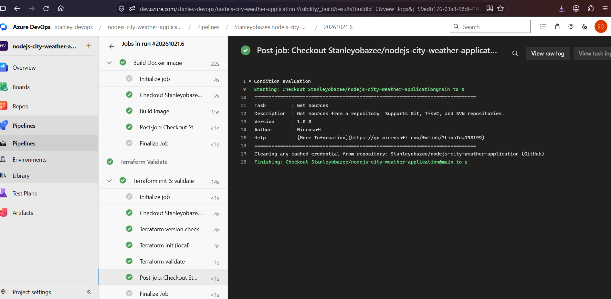
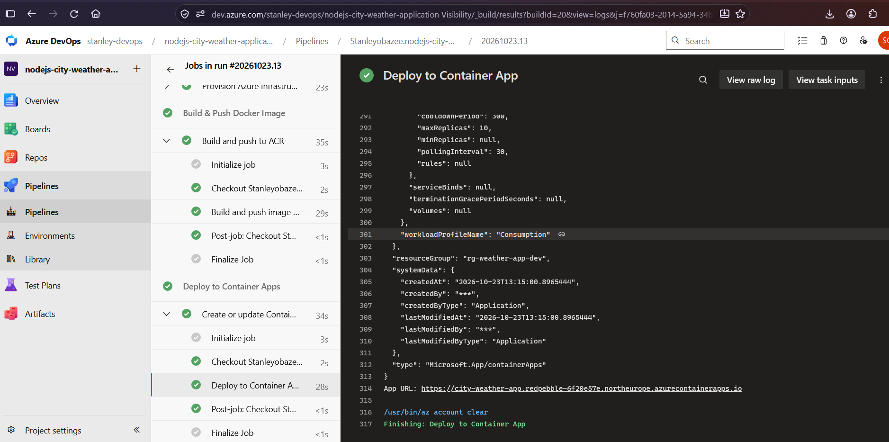
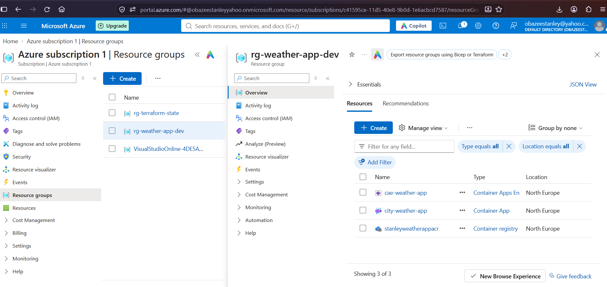
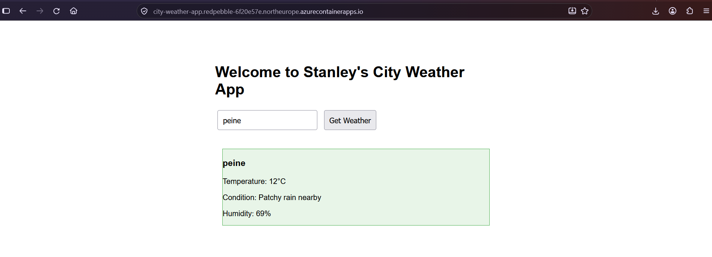
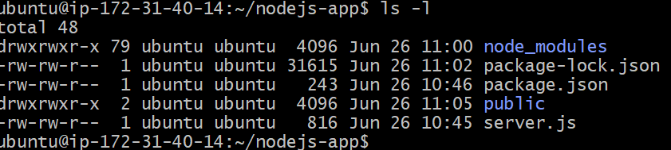
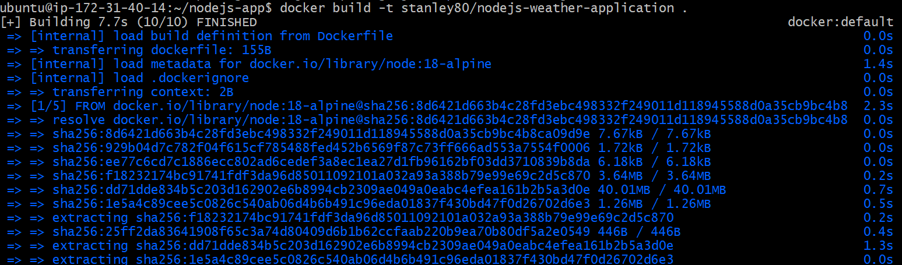
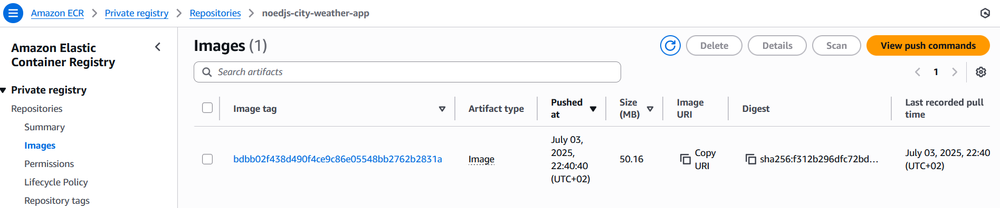
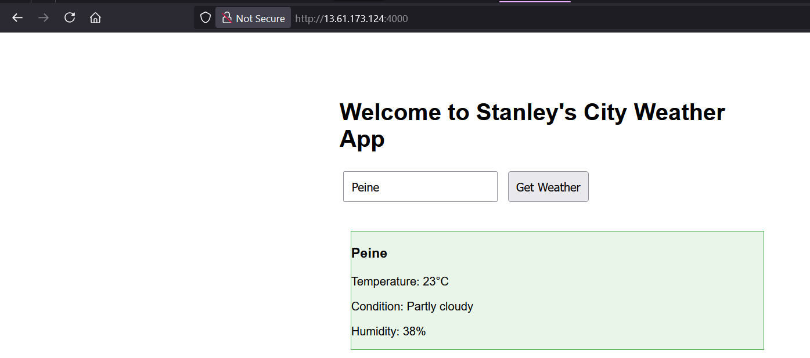

# City Weather Application

A Node.js web application that delivers real-time weather data for any city worldwide. This project documents a **real-world evolution of a DevOps setup** — starting with a GitHub Actions deployment to AWS EC2, then extended with a full **Azure DevOps multi-stage CI/CD pipeline** backed by **Terraform-managed infrastructure** deploying to **Azure Container Apps**.

> **Note:** The Azure resources were provisioned, verified end to end, and then torn down with `terraform destroy` to avoid ongoing cost. The screenshots below are the record of that deployment; the live URL is no longer active.

---

## Project Evolution

| Version | CI/CD | Cloud | Deployment target | IaC |
|---|---|---|---|---|
| v1 (original) | GitHub Actions | AWS | EC2 (Docker container) | None — manual setup |
| v2 (current) | Azure DevOps Pipelines | Azure | Container Apps | Terraform |

Both pipelines are present in the repository. The GitHub Actions workflow is retained for reference as `.github/workflows/deploy.yml.disabled` and is switched off in favour of the Azure DevOps pipeline.

---

## Architecture — v2 (Azure DevOps + Terraform)

```
GitHub (source)
      │
      ▼
Azure DevOps Pipeline
      │
      ├── Stage 1 · Build & Validate
      │     └── Node.js install, ESLint, smoke test
      │
      ├── Stage 2 · Infrastructure (Terraform)
      │     └── Azure Resource Group
      │         Azure Container Registry (ACR)
      │         Azure Container App Environment
      │
      ├── Stage 3 · Docker Build & Push
      │     └── Build image → push to ACR
      │
      └── Stage 4 · Deploy
            └── az containerapp create / update
                Public HTTPS endpoint exposed
```

**Cloud provider:** Microsoft Azure  
**Region:** North Europe  
**IaC:** Terraform (azurerm ~3.0, remote state in Azure Blob Storage)

---

## Architecture — v1 (GitHub Actions + AWS EC2)

```
GitHub (source)
      │
      ▼
GitHub Actions Workflow
      │
      ├── Configure AWS credentials
      ├── Login to Amazon ECR
      ├── Build and push Docker image to ECR
      └── SSH into EC2 instance
            └── Pull new image from ECR
                Stop and remove old container
                Run new container on port 4000
```

**Cloud provider:** AWS  
**Services:** Amazon EC2, Amazon ECR  
**Auth:** IAM credentials via GitHub Secrets, SSH key for EC2 access

---

## Tech Stack

| Layer | Technology |
|---|---|
| Runtime | Node.js 18, Express.js |
| Frontend | HTML, CSS, Vanilla JavaScript |
| Weather data | [wttr.in](https://wttr.in) API |
| Containerisation | Docker (node:18-alpine) |
| Container registry (Azure) | Azure Container Registry (ACR) |
| Container registry (AWS) | Amazon ECR |
| Deployment target (Azure) | Azure Container Apps |
| Deployment target (AWS) | Amazon EC2 |
| IaC | Terraform (Azure infrastructure) |
| CI/CD (current) | Azure DevOps Pipelines (YAML, multi-stage) |
| CI/CD (original) | GitHub Actions |
| Linting | ESLint |

---

## CI/CD — Azure DevOps Pipeline

The pipeline is defined in [`azure-pipelines.yml`](./azure-pipelines.yml) and runs automatically on every push to `main` (and on pull requests, where only the Build stage's checks are meaningful — see Stage 2).

### Stage 1 — Build & Validate
- Installs Node.js 18 and project dependencies
- Runs ESLint (`npm test`) to enforce code quality
- Smoke-tests the application by starting the server and requesting `http://localhost:4000` (non-blocking, since the weather API may be unreachable in CI)

### Stage 2 — Infrastructure (Terraform)
- Runs `terraform init` with a remote backend (Azure Blob Storage) so state is preserved across runs
- Runs `terraform validate`
- Runs `terraform apply -auto-approve` to provision:
  - Azure Resource Group
  - Azure Container Registry
  - Azure Container App Environment
- Terraform runs in the official `hashicorp/terraform` Docker image
- Skipped on pull requests — only runs on pushes to `main`

### Stage 3 — Docker Build & Push
- Authenticates to ACR through the Azure service connection (`AzureCLI@2` task)
- Builds the Docker image tagged with the pipeline build ID and `latest`
- Pushes both tags to ACR

### Stage 4 — Deploy
- Creates or updates the Container App via Azure CLI
- Configures external ingress on port 4000
- Prints the public HTTPS URL to the pipeline log

---

## CI/CD — GitHub Actions (AWS, v1)

The original workflow is in [`.github/workflows/deploy.yml.disabled`](./.github/workflows/deploy.yml.disabled) (renamed so GitHub no longer runs it).

On every push to `main` it:
1. Configures AWS credentials from GitHub Secrets
2. Logs in to Amazon ECR
3. Builds the Docker image and pushes it to ECR tagged with the commit SHA
4. SSHs into the EC2 instance and runs the new container, replacing the previous one

---

## Infrastructure as Code — Terraform

```
terraform/
├── main.tf        # Provider config and remote state backend (Azure Blob Storage)
├── variables.tf   # Input variables (resource group, location, ACR name, app name)
├── resources.tf   # Azure Resource Group, ACR, Container App Environment
└── outputs.tf     # ACR login server, Container App Environment ID
```

Remote state is stored in an Azure Storage Account so infrastructure changes are tracked and idempotent across pipeline runs. The Container App itself is created by the Deploy stage through the Azure CLI rather than by Terraform.

---

## Local Development

### Prerequisites
- Node.js v18+
- npm
- Docker (optional)

### Run locally

```bash
git clone https://github.com/Stanleyobazee/nodejs-city-weather-application.git
cd nodejs-city-weather-application
npm install
npm start
```

Open [http://localhost:4000](http://localhost:4000).

### Run with Docker

```bash
docker build -t city-weather-app .
docker run -p 4000:4000 city-weather-app
```

---

## API

### `GET /weather/:city`

**Example:**
```bash
curl http://localhost:4000/weather/Berlin
```

**Response:**
```json
{
  "city": "Berlin",
  "temperature": 8,
  "description": "Partly cloudy",
  "humidity": "72"
}
```

---

## Project Structure

```
├── .github/
│   └── workflows/
│       └── deploy.yml.disabled   # GitHub Actions — AWS EC2 deployment (disabled)
├── public/
│   └── index.html                # Frontend UI
├── screenshots/                  # Azure and AWS deployment screenshots
├── terraform/
│   ├── main.tf
│   ├── variables.tf
│   ├── resources.tf
│   └── outputs.tf
├── azure-pipelines.yml           # Azure DevOps multi-stage pipeline
├── Dockerfile
├── server.js                     # Express application
├── package.json
└── .eslintrc.json
```

---

## Azure DevOps Setup

To run the Azure pipeline in your own organisation:

1. Create a service principal with Contributor role on your Azure subscription
2. Create a storage account and `tfstate` blob container for Terraform remote state, and update the `backend` block in `terraform/main.tf` to match
3. Add the following pipeline secret variables:
   - `ARM_CLIENT_ID`
   - `ARM_CLIENT_SECRET`
   - `ARM_TENANT_ID`
   - `ARM_SUBSCRIPTION_ID`
   - `TF_BACKEND_ACCESS_KEY`
4. Create an Azure Resource Manager service connection named `azure-weather-app`
5. Push to `main` to trigger the pipeline

---

## Screenshots

### v2 — Azure DevOps + Terraform + Container Apps

#### Pipeline — Build & Terraform stages green



#### Pipeline — Deploy stage complete, app URL printed



#### Azure Portal — Resource group with all provisioned resources



#### Live application on Azure Container Apps



### v1 — GitHub Actions + AWS EC2

#### EC2 instance — application files



#### Docker image build on EC2



#### Image stored in Amazon ECR



#### Live application on AWS EC2



---

## License

MIT
